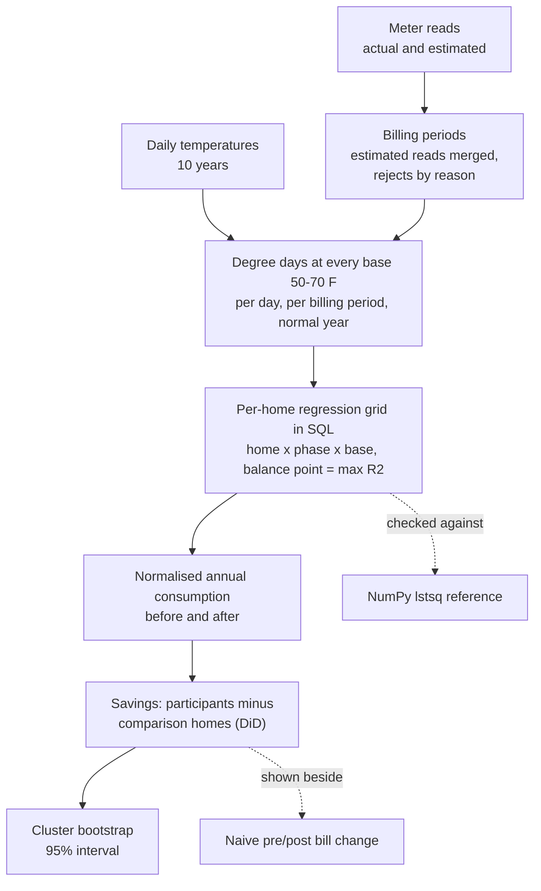

# weathernorm

[](https://github.com/SlateGitOrg/weathernorm/actions/workflows/ci.yml)


weathernorm estimates what a home-insulation retrofit programme saved on gas bills without booking a mild winter as savings. Each home gets its own degree-day balance point, found by running 21 regressions per home and phase in DuckDB SQL; consumption is normalised to a typical year, and the programme's saving is the participants' change net of the change in a comparison group that went through the identical procedure. A cluster bootstrap gives the interval, NumPy least squares re-checks every SQL fit, and the naive before/after bill comparison is printed next to the result so the weather effect can be read off rather than argued. All data is synthetic and seeded.

## The problem

A gas utility has to report how many therms a retrofit programme saved. Three things distort the obvious answer:

- Comparing bills before and after credits the programme with the weather. If the winter after the retrofit is 15% milder, every home's bill falls whether or not it was insulated.
- Meter reads arrive on irregular cycles of about a month, some are estimates that the next actual read corrects, and a meter swap produces a negative interval. Months built from these reads are not comparable.
- A single 65 F base temperature for degree days fits poorly when homes are heated to different set points, so the weather adjustment itself is noisy and the regulator discounts the claim.

## How it works



The pipeline is five SQL files run in order on an in-process DuckDB, with parameters from `config.yaml`:

1. `sql/010_billing_periods.sql` turns reads into periods that run from one actual read to the next, merging each estimated read into the period it falls in. Every period gets at most one reject reason, tested in this order: `negative_consumption`, `too_short` (under 20 days), `too_long` (over 40 days after merging) and `blackout` (overlaps the calendar month of the home's retrofit). Accepted periods are labelled `pre` or `post`.
2. `sql/020_degree_days.sql` computes daily heating degree days at every base from 50 to 70 F, sums them per billing period with a date-range join, and builds the normal year: mean HDD by calendar day over all 10 years, 29 February dropped.
3. `sql/030_fit.sql` fits therms/day on HDD/day by ordinary least squares (`regr_slope`, `regr_intercept`, `regr_r2`, `regr_count`) for every home, phase and base. The chosen base maximises R2, ties going to the lower base. A chosen fit fails with `insufficient_periods` (fewer than 9 periods) or `no_heating_signal` (slope not positive).
4. `sql/040_nac.sql` computes normalised annual consumption, `NAC = 365 * alpha + beta * HDD_normal(base)`, per home and phase.
5. `sql/050_savings.sql` computes home savings (`NAC_pre - NAC_post`), the programme difference in differences, and the naive raw-bill change.

Python wraps the SQL: `synth.py` generates the data, `pipeline.py` loads it and runs the files, `check.py` refits any home, phase and base with `numpy.linalg.lstsq`, `bootstrap.py` resamples homes, and `report.py` writes the Markdown report. Running with a fixed base (default 65 F) repeats the whole pipeline with a single candidate base, and the report shows the two side by side.

### The synthetic data

`weathernorm generate` writes, from one seed:

- 10 years of daily mean temperature (annual sinusoid with mean 50 F and amplitude 22 F plus AR(1) noise). The last three years are the analysis window. The winter after the retrofits (1 October 2024 to 30 April 2025) is shifted warmer until its HDD65 is 15% below the other winters.
- 600 homes: 300 participants retrofitted on staggered dates between June and August 2024, and 300 comparison homes that were never retrofitted. Each home has a true integer base temperature (uniform 55-65 F), a baseload alpha (0.8-2.5 therms/day) and a heating slope beta (0.10-0.25 therms/HDD). The retrofit cuts beta by exactly 18% and leaves alpha unchanged. The generator writes each home's true values and the programme's true savings to `truth_homes.csv` and `truth.json`, which the analysis never reads.
- About 21,000 meter reads at 27-35 day intervals with 3% multiplicative noise. Injected defects: 8% of reads are estimated (the same dates a year earlier) and the next actual read catches up; 6 homes have a meter swap that produces one negative interval; 12 homes moved in late and have under 9 pre-retrofit periods; each retrofit month is a blackout.
- Comparison homes carry a reference date drawn from the same distribution as the retrofit dates, so they are cut into pre, blackout and post periods exactly like participants.

## Quick start

```bash
python -m venv .venv && . .venv/bin/activate
pip install -e ".[dev]"

weathernorm generate --out data      # synthetic weather, homes, reads and truth
weathernorm run --data data --out out  # SQL pipeline, per-home and fixed 65 F; writes out/report.md
weathernorm savings                  # programme savings table
weathernorm home 5 --span 3          # one home's R2-by-base curve and chosen fit
weathernorm audit                    # rejected periods and failed fits by reason
pytest -q
```

`weathernorm run --fixed-base 60` compares against a different fixed base, and `--no-fixed` skips that run.

## Example output

Programme savings (`weathernorm savings`, seed 7). NAC is normalised annual consumption; "DiD" is the participants' mean NAC change minus the comparison homes' mean NAC change:

```text
                                        Programme savings
┏━━━━━━━━━━━━━━━━━━━━━━━━━━━━━━━━━━━━━━━━━━━━━━━━━━━━━┳━━━━━━━━━━━━━━━━━━━━━━━━┳━━━━━━━━━━━━━━━━━┓
┃ Measure                                             ┃ Per-home balance point ┃      Fixed 65 F ┃
┡━━━━━━━━━━━━━━━━━━━━━━━━━━━━━━━━━━━━━━━━━━━━━━━━━━━━━╇━━━━━━━━━━━━━━━━━━━━━━━━╇━━━━━━━━━━━━━━━━━┩
│ Homes in the estimate (participants / comparison)   │              285 / 284 │       285 / 284 │
│ Participants' NAC change, therms per year           │                  152.0 │           153.3 │
│ Comparison homes' NAC change, therms per year       │                   -0.8 │             3.7 │
│ Programme savings (DiD), therms per year            │                  152.8 │           149.7 │
│ Programme savings (DiD), % of participants' pre NAC │                 10.48% │          10.31% │
│ 95% bootstrap interval, %                           │       10.18% to 10.78% │ 9.91% to 10.70% │
│ Participants' NAC change, %                         │                 10.42% │          10.57% │
│ Comparison homes' NAC change, %                     │                 -0.05% │           0.26% │
│ Spread of comparison homes' NAC change, std dev %   │                   1.52 │            2.55 │
│ Naive pre/post bill change, participants            │                 21.53% │          21.53% │
│ Pre/post bill change, comparison homes              │                 13.31% │          13.31% │
│ True programme savings (generator)                  │                 10.34% │          10.34% │
└─────────────────────────────────────────────────────┴────────────────────────┴─────────────────┘
```

The generator's true programme saving is 10.34%, so the per-home estimate is 0.14 points high and its interval contains the truth. The naive bill comparison reports 21.53%, twice the truth: comparison homes, which were never touched, also saw their bills fall 13.31%, because the winter was milder. Their NAC change is -0.05%, so the weather adjustment removes it. The fixed 65 F run lands at 10.31% too: the comparison group cancels most of a poor weather adjustment, so at programme level the base choice moves the answer little. It shows up at home level. Comparison homes did nothing, so the spread of their NAC change is pure method noise, and it is 1.52% with per-home balance points against 2.55% at a fixed 65 F.

Balance-point recovery and fit quality (from `out/report.md`): of the 288 participants with an accepted pre-phase fit, 99.0% chose a base within 2 F of the home's generated set point (mean absolute error 0.59 F, bias +0.01 F). Mean R2 over the 1,169 home-phase fits that both runs could fit is 0.9961 with per-home balance points and 0.9839 with the fixed base.

One home's R2-by-base curve (`weathernorm home 5 --span 3`, pre phase). Its generated set point is 57 F; the curve peaks at 57 and the SQL fit agrees with NumPy least squares to 6e-16:

```text
Home 5: participant, event date 2024-08-03
Generated set point 57 F, alpha 1.200, beta 0.1867
                    R2 by base, pre phase
┏━━━━━━━━┳━━━━━━━━━┳━━━━━━━━━┳━━━━━━━━━━━┳━━━━━━━━━┳━━━━━━━━┓
┃ Base F ┃ Periods ┃   Slope ┃ Intercept ┃      R2 ┃        ┃
┡━━━━━━━━╇━━━━━━━━━╇━━━━━━━━━╇━━━━━━━━━━━╇━━━━━━━━━╇━━━━━━━━┩
│     54 │      13 │ 0.20309 │    1.3672 │ 0.98808 │        │
│     55 │      13 │ 0.19622 │    1.3137 │ 0.99100 │        │
│     56 │      13 │ 0.19000 │    1.2558 │ 0.99302 │        │
│     57 │      13 │ 0.18419 │    1.1964 │ 0.99408 │ chosen │
│     58 │      13 │ 0.17872 │    1.1374 │ 0.99406 │        │
│     59 │      13 │ 0.17362 │    1.0772 │ 0.99296 │        │
│     60 │      13 │ 0.16873 │    1.0196 │ 0.99085 │        │
└────────┴─────────┴─────────┴───────────┴─────────┴────────┘
pre: base 57 F, slope 0.18419, intercept 1.1964, R2 0.99408, 13 periods, status ok
NumPy lstsq check: max relative difference 5.58e-16
                   R2 by base, post phase
```

Audit counts (`weathernorm audit`):

```text
         Rejected billing periods
┏━━━━━━━━━━━━━━━━━━━━━━┳━━━━━━━━━┳━━━━━━━┓
┃ Reason               ┃ Periods ┃ Homes ┃
┡━━━━━━━━━━━━━━━━━━━━━━╇━━━━━━━━━╇━━━━━━━┩
│ blackout             │     972 │   540 │
│ negative_consumption │       6 │     6 │
│ too_long             │    1414 │   562 │
└──────────────────────┴─────────┴───────┘
              Failed fits
┏━━━━━━━━━━━━━━━━━━━━━━┳━━━━━━━┳━━━━━━┓
┃ Reason               ┃ Phase ┃ Fits ┃
┡━━━━━━━━━━━━━━━━━━━━━━╇━━━━━━━╇━━━━━━┩
│ insufficient_periods │ post  │    8 │
│ insufficient_periods │ pre   │   23 │
└──────────────────────┴───────┴──────┘
```

All 6 meter-swap homes appear once under `negative_consumption`. Every period that absorbs an estimated read is longer than 40 days, so it is rejected as `too_long`, which is where the estimated reads go. Of the 23 pre-phase `insufficient_periods` fits, 12 are the injected late move-ins; the other 11 and the 8 post-phase failures are homes where merged estimated reads and the blackout left fewer than 9 periods.

## Design decisions

- **Estimated reads are merged, and the merged period is usually rejected.** An estimated read is a guess, not a measurement, so a period always runs between two actual reads. A period that absorbs an estimate spans two intervals (about 60 days) and fails the 40-day cap. This keeps every regression input a real meter measurement and conserves total therms, at the cost of about 1,400 periods and a handful of homes dropping under 9 periods. Interpolating the estimate instead would keep the data but put the utility's own estimating error into the regressions.
- **The balance point comes from a grid search on R2, not a changepoint fit.** Twenty-one ordinary regressions per home and phase are plain SQL aggregates, easy to audit and to reproduce with `lstsq`. The cost is an integer-degree resolution and a flat top: neighbouring bases usually differ in R2 only in the third decimal, as the example home shows, so a base within 2 F is the realistic target, not the exact set point.
- **Comparison homes run through the same procedure and share the participants' phase logic.** Because they carry a placebo reference date, the blackout, phases and fits are identical code paths, so anything the procedure does to a home that did nothing shows up in the comparison group's NAC change. The assumption is that the two groups are exchangeable; here the generator makes them so, whereas real comparison groups need matching and a parallel-trends check.
- **Programme percentage is a ratio of means.** The DiD in therms is divided by the participants' mean pre-phase NAC, which is also how the generator defines the true percentage. A mean of per-home percentages would weight small homes more and would not equal the true programme saving.
- **The bootstrap resamples homes, within each group.** A home is the cluster; its pre and post fits travel together. Participants and comparison homes are resampled separately so each resample keeps the group sizes. It treats fitted NAC values as data, so it does not include the extra uncertainty from the regressions themselves; the interval is a lower bound on the true uncertainty.
- **DuckDB runs on one thread.** Parallel floating-point aggregation can change the last digits from run to run. With one thread and an explicit `ORDER BY` on every output table, re-running on the same inputs gives identical tables, which a test checks. The data is small enough that this costs about a second.

## Testing

```bash
pytest -q
```

The 75 tests run offline in about eight seconds and fail on any warning. They cover:

- the SQL regression against `numpy.linalg.lstsq` for 50 random (home, phase, base) triples (agreement to 1e-9 relative; the observed worst case is around 1e-13), plus a noise-free home whose base, slope, intercept and NAC are known exactly;
- hand-built reads for each reject reason and the merging rule, and the conservation of therms (accepted plus rejected equals the sum of all read deltas) for every home;
- the injected defects: all 6 meter-swap homes rejected as `negative_consumption`, the 12 late move-ins failing with `insufficient_periods`, no period overlapping a retrofit month in either phase;
- recovery on the seeded data: chosen base within 2 F of the set point for at least 90% of participants, DiD within 2 points of the true programme saving with the bootstrap interval containing it, naive saving at least 5 points above the truth, comparison bills falling at least 6% while their NAC change stays within 2%, and fixed-base fits with lower mean R2;
- fit failures (`insufficient_periods`, `no_heating_signal`, the lower-base tie-break), degree-day arithmetic and the normal year (29 February dropped), the bootstrap's coverage, determinism of reruns, and the CLI.

## Project layout

```text
weathernorm/
├── config.yaml              synthetic-data and pipeline parameters
├── sql/
│   ├── 010_billing_periods.sql
│   ├── 020_degree_days.sql
│   ├── 030_fit.sql
│   ├── 040_nac.sql
│   └── 050_savings.sql
├── src/weathernorm/
│   ├── synth.py             seeded weather, homes, reads and truth
│   ├── pipeline.py          loads inputs, runs the SQL files in order
│   ├── check.py             NumPy lstsq reference, base-recovery scoring
│   ├── bootstrap.py         cluster bootstrap for the DiD interval
│   ├── report.py            summaries and the Markdown report
│   ├── config.py            typed access to config.yaml
│   └── cli.py               generate, run, home, savings, audit
└── tests/
```

## License

MIT. See `LICENSE`.
